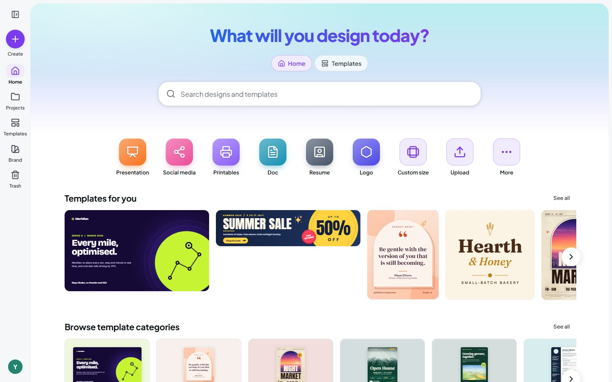
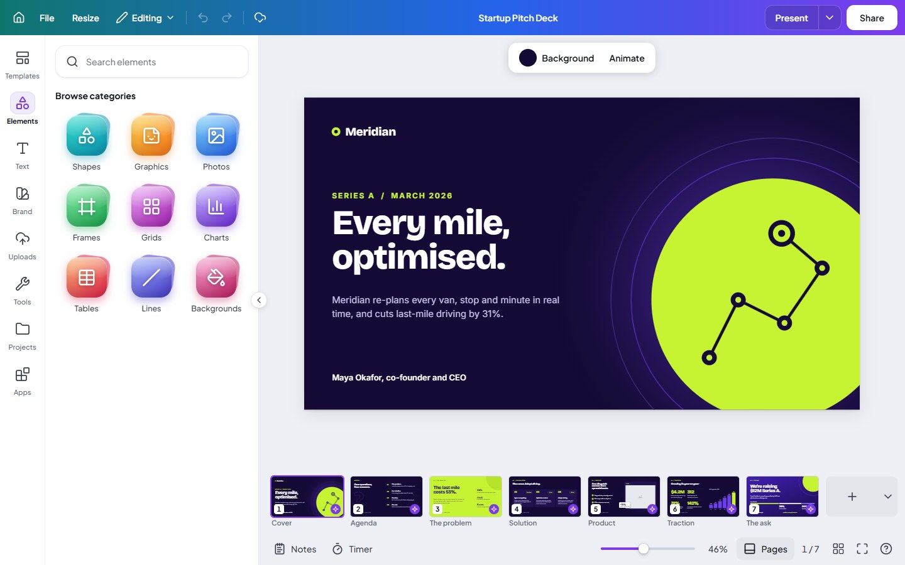
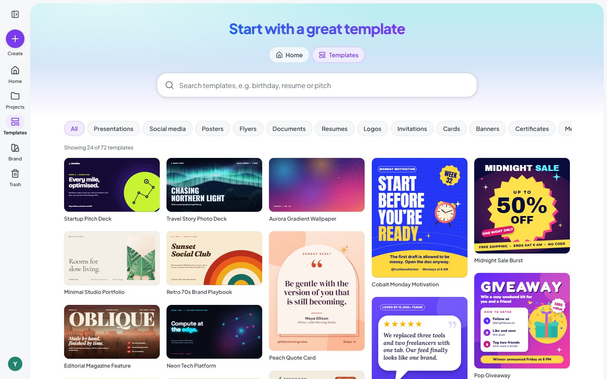

# Craftly

A standalone, Canva-style design studio that runs entirely in your browser: a dashboard, a drag-and-drop canvas editor, 102 templates, multi-page designs, animation with a full-screen presenter, and export to PNG, JPG, PDF, SVG, animated GIF and WebM video. The editor works offline after its first load and keeps designs on your device by default. Optional live editing sends shared designs and their uploads to a Craftly server you choose. The local editor requires no account.



| The editor, opened from a template | The templates browser |
| --- | --- |
|  |  |

> Craftly is an independent project and is not affiliated with or endorsed by Canva. Its name, logo, templates, illustrations, photos and code are original; fonts come from [Fontsource](https://fontsource.org) (open fonts) and interface icons from [Lucide](https://lucide.dev) (ISC). The AI tools (**Remove background**, **Blur background**, **Colour pop** and **Upscale**) run on your own device (see [On-device AI](#on-device-ai)); [`docs/ROADMAP.md`](docs/ROADMAP.md) has the analysis and the plan for more.

Jump to: [Quick start](#quick-start) - [What you get](#what-you-get) - [On-device AI](#on-device-ai) - [Using Craftly](#using-craftly) - [Browser support](#browser-support) - [Develop](#develop) - [Deploy](#deploy) - [Privacy and your data](#privacy-and-your-data) - [Credits and licences](#credits-and-licences) - [Keyboard shortcuts](#keyboard-shortcuts) - [Known limitations](#known-limitations)

## Why Craftly

- **Local by default.** Designs, uploads and your brand kit live in IndexedDB. Starting or joining a live session uses the selected server.
- **Works offline.** After the first visit a service worker stores the whole app, so the dashboard, the editor and your saved designs open with the network off.
- **Fast.** Measured in Chrome on a fast desktop: the dashboard is ready in about half a second, a presentation opens in about two, and editing a page of 1,000 elements stays at 60 frames per second. Dragging stays smooth on heavy pages too (150 text boxes, 40 filtered photos, 60 blended shapes), because only what moves is painted during a drag: measured before and after on a laptop of 2018 in [`docs/PERFORMANCE.md`](docs/PERFORMANCE.md). Zooming a very full page is the slow case on weak CPUs (see [`docs/ROADMAP.md`](docs/ROADMAP.md)).
- **Verification.** See the [test results and release limits](docs/VERIFICATION.md#production-readiness-regressions) for the full coverage status, the 16 regression cases and the browser journeys.
- **Easy to change.** A design is plain JSON, and one renderer paints the editor, the thumbnails and every raster, PDF and video export (the SVG writer mirrors it), so what you see is what you export.

## Quick start

```bash
npm install
npm run dev        # http://127.0.0.1:5173
```

On Windows you can also double-click `start.bat` (installs on the first run, then opens the browser).

Requires Node 22.22.2+, 24.15+ or 26+ (the test tools need these; the dev server and the build alone also run on Node 20.19+). If this folder is inside OneDrive, exclude `node_modules` from syncing (it holds about 18,000 files). The project overrides `rollup` with its WebAssembly build (`@rollup/wasm-node`), so it builds on machines whose application-control policy blocks native `.node` modules; do not add dependencies that need native add-ons.

## What you get

| Area | Highlights |
| --- | --- |
| **Dashboard** | Home with search, design-type shortcuts, recent designs, template carousels; Projects with folders, stars, drag-to-folder, sort and filter; Templates browser with previews; Brand kit (logos, colours, fonts, and the fonts you upload); Trash with restore |
| **Canvas** | Click / shift-click / marquee selection, move, 8-handle resize (corners proportional, Alt = from centre), rotation with snapping (45 degrees, or 15 with Shift), flip, group / ungroup, z-order, align and distribute, smart snapping to page, elements and guides, rulers and draggable guides, margins that can be shown and snapped to, zoom from 5 % to 400 % (wheel and keys; the slider covers 10-300 %; fit / fill), pan (space-drag), on a touch screen pinch to zoom and two fingers to move the view, keyboard nudging, lock and hide |
| **Templates** | 102 original templates (175 pages): 10 seven-page presentation decks, 24 social posts, stories and thumbnails, 9 posters, 8 flyers, 6 documents, 7 resumes, 8 logos, 7 invitations, 7 business and greeting cards, 5 certificates, 5 menus and 6 banners and wallpapers. Start a design from one, apply a whole deck, or drop a single page onto the current page (with undo) |
| **Elements** | Text, 47 shapes (45 drawings, plus a rounded square and an ellipse that reuse two of them; a polygon, a star, a burst, a ring and the scalloped shapes have **Shape options** for their sides, points and depth), lines and arrows, 2,000+ icons, 161 hand-drawn illustrations, 44 procedural stock photos, frames and photo grids, 136 backgrounds (colours, gradients, patterns, textures), tables and charts that can be filled from data (paste cells copied from a spreadsheet, or import a `.csv`, `.tsv` or `.txt` file, in the Data panel; up to 200 rows by 50 columns for a table, 100 rows by 12 series for a chart; a bar or column chart can stack its series, and a chart with axes can have a title along each), freehand drawing, a **Pen** for paths of straight sides and curves with point editing ([the Pen tool](#the-pen-tool)), **Combine** to make one shape of several (union, subtract, intersect, exclude; [combining shapes](#combining-shapes)), and **Convert to shapes**, which takes an illustration, an icon or an uploaded SVG apart into shapes whose points, fills and outlines can be edited ([converting a drawing to shapes](#converting-a-drawing-to-shapes)) |
| **Text** | 44 bundled font families and **your own fonts** (upload `.ttf`, `.otf`, `.woff` or `.woff2` files under Brand kit > Your fonts; they appear at the top of the font list, and several files form one family with its real bold and italic), every weight of a family that has more than regular and bold (the Font panel's **Weight**), size, colour and gradient, bold / italic / underline / strike, case, alignment (incl. justify), bullet and numbered lists, letter and line spacing, per-selection formatting, nine effects (shadow, lift, hollow, splice, outline, echo, glitch, neon, background), curved text |
| **Media** | Upload by button, drag-and-drop or paste; asset manager; replace images; drop photos onto frames, or cut a photo that is on the page already to one of 16 frame shapes (**Frame shape** in the image toolbar); crop with live zoom and reposition, and a fixed shape for the frame (the picture's own, 1:1, 4:3, 3:2, 16:9 and their upright forms); filters, adjustments, duotone, shadow, blur, corner radius, borders; **Remove background**, **Blur background**, **Colour pop** and **Upscale** (2x or 4x) with AI models that run on your device |
| **Apps** | The rail's Apps tab: a QR code (for a link, Wi-Fi or text), emoji, lorem ipsum, a placeholder image, a colour palette pulled from a picture, and **Bulk create**, which makes a page for every row of a spreadsheet ([Bulk create](#bulk-create)); all of them work in the browser |
| **And more** | Resize with a ratio lock (or into a copy), find and replace text, alternative text for pictures, a check of the design for text that does not stand out and pictures without alternative text (**File > Check accessibility**), spell-check by the browser when you ask for it (**File > Check spelling while typing**, off to begin with), a link on any element (**Link** in the right-click menu: a click on the element opens the address in the presenter, a PDF and an SVG), rulers and guides, version history, print |
| **Blend modes** | Fifteen blend modes (Multiply, Screen, Overlay, Difference, Hue and the rest) on any element or group, set in the Transparency popover of the toolbar; the same in the editor, the presenter and every export, see [Blend modes](#blend-modes) |
| **Animation** | An **Animate** button on every toolbar: entrance, exit and emphasis effects per element (fade, rise, pan, pop, zoom, wipe, slide, drop, tumble, typewriter, flicker; breathe, pulse, float, wiggle, spin, flash) with direction, duration and delay; one-click page animations that stagger a whole page; page timing; six transitions between pages (dissolve, slide, push, wipe, zoom, dip to black). Choosing an effect plays the page on the canvas. The ten presentation decks and the story templates ship with motion |
| **Comments** | Pin a note to a place of the page or to an element with the **Comment** tool (Tools palette, or `M`), answer it, edit or delete your own, resolve and reopen; the **Comments** button in the top bar (with the number of open ones) opens the threads of this page and the others, filtered by Open, Resolved or All. Comments travel in project files and backups, are kept by Make a copy, and are never drawn into an export or the presenter; in a live session they are shared with everybody (see [Working together](#working-together)) |
| **Pages** | Add, duplicate, delete, reorder (drag in the strip or grid view), page names, speaker notes. **Present** is full screen and plays the animations and transitions (backwards when you go back), with auto-play on `P`, a clock that counts how long the show has run (a click starts it again) and a red pointer that follows the mouse on `L` |
| **History** | Undo / redo for every action; drags, resizes and slider scrubs are single steps; version history snapshots |
| **Export** | PNG (scale, transparent), JPG (quality), PDF (screen / 300 dpi print, with text you can select, search and copy; the print PDF at 300 or 150 dpi, with a bleed of up to 10 mm, crop and registration marks and optional CMYK colours, see [Printing a PDF](#printing-a-pdf)), SVG (vector with optional embedded fonts), multi-page ZIP, **several sizes at once** (up to ten formats of one design as PNG, JPG or PDF in one ZIP; each from a copy that is refitted like Resize, the design itself is not changed), **PowerPoint** (a `.pptx` file with a slide for every page, each page one picture that fills its slide, speaker notes on request, see [Known limitations](#known-limitations)), a **web page** (one self-contained `.html` slideshow for people without Craftly: pages as pictures, buttons, keys, click and swipe, full screen; no script but its own, nothing loaded from the internet, speaker notes only on request), **animated GIF** (480p / 720p / 1080p, 10 / 15 / 20 fps, loops for ever) and **WebM video** (recorded as it plays), `.craftly` project files, print |
| **Back up and restore** | **Back up & restore** in the account menu writes every design (the trash too), upload, uploaded font, folder, saved version and the brand kit to one ZIP file, and restores it in another browser or after the site's data was cleared. A restore only adds: what is here already is never replaced or deleted, and a design that was edited since the backup comes back as a copy. The dashboard reminds with one quiet line when the last backup is old and designs changed since (every 2 weeks unless you choose 1 week, 1 month or never), and in Chrome and Edge **Keep a backup file up to date** lets **Back up now** write into a file you chose once, with no download. What is in the file, how a restore decides, when the reminder shows and what the browser allows: [`docs/BACKUP.md`](docs/BACKUP.md) |
| **Offline and responsive** | After the first visit a service worker stores the whole app (about 5 MB; the AI runtime and models are fetched when you first use a photo tool). Desktop is the primary layout; tablets keep the side panel, narrow screens switch to a bottom tool dock with a sheet |

## On-device AI

Select a photo, open **Edit image > Tools** and pick a tool. **Restore original** puts the old picture back after any of them, and Undo works as usual.

- **Remove background.** A small neural network ([ISNet general-use](https://github.com/xuebinqin/DIS), Apache-2.0 licence) finds the subject and the photo becomes a PNG with real transparency. On an integrated Intel graphics card it takes about five seconds per photo.
- **Blur background.** The same network finds the subject, and everything behind it is blurred (light, medium or strong) while the subject stays exactly as it was: only the background's own pixels are averaged, so the subject's colours do not bleed into it. It needs no download of its own. The photo keeps its size and its transparency, and a JPEG stays a JPEG. After Undo, another try with another strength does not ask the network again, so it takes about a second. A 12-megapixel photo takes about three to six seconds, and the page stays usable meanwhile.
- **Colour pop.** The subject keeps its colours and everything behind it goes black and white, or faded (60 % of the colour taken out). It uses the same network as the two tools above, so there is nothing more to download. A photo whose background has no colour (black and white already, or transparent) is left alone, with a message that says so. The network counts a contact shadow as part of the subject, so the shadow under an object stays in colour. After Undo, another try with the other style takes about a second.
- **Upscale.** Choose 2x or 4x, and a second network ([Real-ESRGAN general x4 v3](https://github.com/xinntao/Real-ESRGAN), BSD-3-Clause licence) makes the photo larger and draws back the sharpness that a small or soft photo lacks. The photo is worked on in tiles, so there is a progress bar with the time left, and Cancel works at any moment. Transparency is kept, a JPEG stays a JPEG, and the photo keeps its size on the page: only the picture behind it has more pixels. On an integrated Intel graphics card it takes roughly 30 to 40 seconds per megapixel of the original: a small picture is quick, a six-megapixel photograph takes minutes.

- **Your photo never leaves the device.** The model runs in a Web Worker on your graphics card through [ONNX Runtime Web](https://onnxruntime.ai) (WebGPU).
- **One download per model, with your consent.** The background model (Remove background, Blur background and Colour pop share it) is 88.1 MB and the upscaler 4.9 MB. A model is fetched from huggingface.co only after you agree in a dialog that names the size and the host, checked against a pinned size and SHA-256, and kept in this browser. After that the tool works offline. **File > On-device models** lists what is installed (with licences and credits), removes models, and adds a model from a file for a computer that is offline.
- **What it needs.** A browser with WebGPU (Chrome or Edge 113+, Safari 26+, Firefox 141+ on Windows). The background model also needs a graphics card with half-precision shaders (`shader-f16`, true for most cards of the last years); the upscaler does not. Without what a tool needs it says so and offers nothing to download.
- **Your own host.** Build with `VITE_CRAFTLY_MODEL_BASE=https://your.host/models` and the app asks `https://your.host/models/isnet-general.onnx` and `https://your.host/models/realesrgan-general.onnx` instead (the same files; the SHA-256 check still applies).
- **Limits.** A result is at most 25 megapixels and 16,384 pixels a side, so a photo of more than 1.56 megapixels cannot be made 4x larger, and one of more than 6.25 megapixels not even 2x (the tool says so before anything is downloaded). The remover's edges are a little soft on hair and fur, and a contact shadow can stay in the cut-out; there is no brush to touch up the edge yet. Blur background is one blur at every distance, not the depth of field of a lens, and where the outline is soft a thin ring of the sharp background can stay visible along it; a photo whose surround is already transparent is left alone. Colour pop leaves a faint band of the background's colour next to a soft outline, and keeps a contact shadow in colour. The upscaler draws plausible detail where there was none, which is not the same as a sharper original: it can redraw small text and faces convincingly but not faithfully. Locked photos are left alone, and a vector picture (SVG) needs no upscaling.

The design, the licence rules for models and how to add one are in [`docs/ON-DEVICE-AI.md`](docs/ON-DEVICE-AI.md).

## The Pen tool

Pick **Pen** in the Tools palette or press `P`.

- **Place points.** A click puts down a corner point. Press and drag instead to pull a curve out of the point, a handle on each side. Hold `Shift` to keep a side at a multiple of 45 degrees. `Backspace` takes the last point back, and so do `Ctrl+Z` and the Undo button while a path is being placed (they never reach into the design under it; Redo has nothing to bring back until the path is finished).
- **Finish.** Click the first point (once there are three) to close the path: it is filled with the colour of the tool. Click the last point, press `Enter` or `Esc`, or choose another tool to leave the path open: it is a line in the colour and width of the tool (both are in the options next to the tool, shared with Draw). A path of one point makes nothing. Choosing another page in the middle of a path finishes it on the page it was drawn on, and leaves you on the page you chose, with the Pen in hand.
- **Without a pointer.** With the Pen in hand, an arrow key shows a small cross on the page with its place in numbers beside it: in the middle of what is in view, or on the last point of the path. The arrows move it by 1 px (`Shift`: 10 px, the same steps as the nudging of an element) and stop at the edges of the page; the view follows it. `Enter` is its click: it places a corner point there, ends the path when the cross is still on the point just placed (so `Enter` twice ends a path), and closes the path on its first point, where `Home` takes the cross in one step. `Shift+Enter` places a smooth point, whose curve goes on in the direction the path came in, a third as long as the side before it; `Alt` and the arrows pull the curve of the last point (of the first one too) a pixel at a time, `Alt+Shift` ten, and pushing it all the way back makes a corner again. `Backspace`, `Ctrl+Z` and `Esc` do what they do for the pointer. The cross hides as soon as the pointer moves and comes back where it was with the next arrow key; while it is hidden, `Enter` finishes the path as before. A screen reader is told where the cross is when it comes to rest, and what `Enter` would do there. `Space` is not used for placing: held down, it pans the canvas.
- **It is an ordinary shape.** The path is one undo step, and colour, outline, effects, size, rotation, flips, animation and every export treat it like any other shape (SVG export writes a real `<path>` with the curves).
- **Edit the points.** Select a path and press `Enter`, double-click it, or use **Edit points** in the toolbar. Click a point to select it (`Shift` adds or removes one) and drag to move it, with every selected point; drag a handle to reshape the curve (`Alt` moves that handle alone, `Shift` gives the other one the same length); click the path to add a point without changing its shape; double-click a point to turn it between a corner and a smooth point. The toolbar has **Corner**, **Smooth**, **Delete point**, **Close path** and **Done**. The keys work too: `Tab` / `Shift+Tab` walk through the points and then, after the last one (or before the first), on to the toolbar, so that every button can be reached from the keyboard; the arrows move the selected ones (`Shift` = 10 px), `Delete` removes them, `Enter` or `Esc` is done. A locked path is not opened. Nothing moves on the page while its box is adjusted, also when the path is turned or mirrored, and each gesture is one undo step.
- **What can be edited.** Paths of straight sides and curves in one piece: the Pen's own, the ones the freehand Draw tool makes, and the ones that [Combine and Convert to path](#combining-shapes) and [Convert to shapes](#converting-a-drawing-to-shapes) make in one piece. A path with arcs or several pieces (a hole, or two shapes apart) cannot be edited point by point (there is no Edit points button).
- **Text into points.** **Convert to shapes**, in the right-click menu and the "..." menu, turns a text box into the outlines of its letters, one path for each, whose points can be edited (one step of undo brings the text back).
- **Not there yet:** text along a path. From the keyboard a curve always has the same handle on both sides of its point (the pointer can break them apart in point editing), and the freehand Draw tool still needs a pointer. [`reports/Craftly versus Figma.md`](reports/Craftly%20versus%20Figma.md) lists the vector gaps that remain.

## Combining shapes

Select two or more shapes and choose **Combine** in the toolbar, or **Combine shapes** in the right-click menu.

- **Four ways.** **Union** joins the shapes into one outline. **Subtract** cuts the shapes in front out of the one at the back. **Intersect** keeps only what they have in common. **Exclude** takes away what they have in common and keeps the rest.
- **One shape, one undo step.** The result is an ordinary path with the fill, border, effects, link and animation of the shape at the back. It takes the place in the stacking order of the shape that was at the front, and it is selected. The work is done on the outlines (curves stay curves, not pixels), and a turned or mirrored shape is combined where it is drawn.
- **What can be combined.** Shapes that are shown and not locked and on the page itself, not inside a group: the preset shapes, the paths of the Pen and Draw, and earlier results. When nothing is left, for example Intersect on shapes that do not overlap, a message says so and nothing changes.
- **Convert to path.** In the right-click menu (and so in the "..." menu of the toolbar): writes each selected shape as a path where it is, with the same box, turn and look, so that **Edit points** works on a star, an ellipse or a rounded rectangle (the rounded corners become curves). A result of one piece can be edited point by point; one with a hole or in two pieces (Subtract with a shape in the middle, Exclude) cannot yet, but it takes colour, size, effects and every export like any other shape.
- **Loaded when first used.** The geometry is [paper.js](https://paperjs.org) (MIT licence), 112 kB compressed, in a chunk of its own: the editor fetches it the first time you combine shapes, and the stored copy for offline use includes it. Two outlines of 2,000 points each take about a tenth of a second.

## Converting a drawing to shapes

Select a graphic (an illustration, a sticker, an icon) or an uploaded SVG picture and choose **Convert to shapes** in the right-click menu (and so in the "..." menu of the toolbar).

- **What you get.** In one undo step the picture is replaced by a group of ordinary shapes exactly where it was, turned and mirrored as it was (by the shape itself when the drawing is a single one). Every shape is a path with its own fill and outline, in the paint order of the drawing, and one in a single piece opens with **Edit points**. A graphic is converted with the colours and the line width it has in the editor. A message says how many shapes there are.
- **What is read.** `path` with every command (arcs and quadratic curves become cubic curves), `rect` with rounded corners, `circle`, `ellipse`, `line`, `polyline`, `polygon`, groups and drawings inside the drawing with the paint they hand down, every `transform` (worked into the points, so nothing stays a transform), `viewBox`, `width`, `height` and `preserveAspectRatio`, fills and outlines (colours by name, as hex, `rgb()` and `hsl()`, `currentColor`, fill and stroke opacity, line width, ends and corners), `fill-rule="evenodd"` for holes and islands, and linear and radial gradients as fills.
- **What is made simpler, without a word about it.** A gradient keeps its direction or its centre and its colours, moved to where they are on the shape, but the editor's gradient always runs from edge to edge of the shape's box (a radial one from its centre to the farthest corner), so a gradient that was slanted across a stretched shape or had a focal point looks a little different. Dashes become the editor's own dashed line, and dashes of no length with round ends its dotted line: not the lengths of the drawing. The opacity of a group goes to each shape in it, so shapes that overlap inside a see-through group are darker where they overlap.
- **What is made simpler, and counted in the message.** A part that was clipped, masked, filtered or had markers (arrowheads) is converted without them. A gradient on an outline becomes its first colour. A part painted with a pattern keeps only its other paint.
- **What is left out, and counted.** A part that is painted with a pattern only, and a part whose path data or transform cannot be read. When nothing at all could be converted the picture stays as it is.
- **Paths of several pieces.** Pieces that lie apart become shapes of their own. Pieces that touch or lie in one another (a letter with its hole) stay one shape, which keeps the hole but cannot be edited point by point. A single piece that crosses itself is filled where the even-odd rule would have left a gap.
- **What it does not do.** Text, pictures inside the drawing, `<use>` and style sheets are not read: an SVG with any of them is stored as a PNG when it is uploaded, and pixels cannot be converted. The menu offers Convert to shapes for every uploaded picture, because only the file says whether it is a drawing; for a photo a message says so and nothing changes. The crop, mask, filter, border and rounded corners of a picture are not carried over (the whole drawing is converted, also what the crop hid). A picture inside a group has to be taken out first, and a locked one is left alone.
- **Limits.** 500 shapes and 20,000 points per drawing, and 2 million characters of markup. Over that nothing is changed and a message says so.

## Blend modes

Select an element and open **Transparency** in the toolbar: under the slider, **Blend mode** says how the element mixes its colours with what is under it. **Normal**, the default, simply covers it.

- **Fifteen modes.** Darken, Multiply, Color burn, Lighten, Screen, Color dodge, Overlay, Soft light, Hard light, Difference, Exclusion, Hue, Saturation, Color and Luminosity, in the order of a photo editor's list and with the meaning they have in CSS and in a canvas. Multiply darkens (a shadow or a texture over a photo), Screen lightens (light, glow), Overlay and Soft light add contrast. Over the empty white of a page Multiply leaves a colour as it is and Screen turns it white.
- **Any element, one step.** Shapes, lines, texts, photos, graphics, tables and charts, one or several selected at once (the box says Mixed when they differ), one step of undo. It works together with transparency (the mixed result is made transparent), shadows and blur.
- **A group mixes as one.** Its elements are painted on top of each other as usual and the result is mixed with what is under the group; an element inside a group can have a mode of its own, mixed with the other elements of that group. Ungrouping gives the mode of the group to the elements that have none of their own.
- **The same everywhere.** The editor, the thumbnails, the presenter and the PNG, JPG, PDF, GIF and WebM exports are painted by one routine. An SVG gets a `mix-blend-mode` style on a group around the element, which a browser draws as the editor does (checked in Chrome against the formulas of the W3C compositing standard: all fifteen modes on the page, in the PNG and in the SVG); a program that does not know the style shows the element as Normal.
- **One optional field.** `blend` on an element, so designs made before open unchanged, and a design with modes opens in an older Craftly as Normal. How it works, and what is not done: [`docs/BLEND-MODES.md`](docs/BLEND-MODES.md).

## Connecting shapes

Select exactly two elements (shapes, texts, pictures, a group as a whole) and choose **Connect** in the toolbar, next to Group and Align, or in the right-click menu. An arrow is drawn from the one you selected first to the other.

- **It stays attached.** The arrow ends in the middle of the sides that face each other, and it follows them: move, resize or turn either element and the arrow is aimed again in the same step of undo. Delete a shape and its arrows go with it (undo brings both back). Move an arrow by hand and it lets go, and stays where you put it.
- **Copies keep to each other.** Duplicate or paste an arrow together with its shapes, or copy the page, and the copy is attached to the copies. An arrow copied on its own is a free arrow.
- **Combine and groups.** Combining shapes hands their arrows to the new shape. A shape that you put in a group lets go of its arrows (they stay where they are): nothing inside a group can be attached to, but an arrow inside a group moves with it.
- **Not there yet:** elbow and curved routes, text on an arrow or inside a shape, and drawing an arrow by dragging from a shape. The plan is in [`docs/PLAN-DIAGRAMS-AND-COLLABORATION.md`](docs/PLAN-DIAGRAMS-AND-COLLABORATION.md).

## Bulk create

Name badges, certificates, price tags, one card for every guest: lay out one page, and **Apps > Bulk create** makes a copy of it for every row of a spreadsheet.

- **Bring the data.** Paste rows copied from a spreadsheet, or choose a `.csv`, `.tsv` or `.txt` file. The first row names the columns; up to 100 rows under it and 50 columns are used, and the panel says what was left out. The data is text and nothing else, and it is kept only while the editor is open.
- **Say where a column goes.** Write its name between double braces, `{{Name}}`, in any text box or in a cell of a table; the panel has a button for every column that adds such a text box. Capitals and spaces in the name do not matter, braces may sit in the middle of a sentence, and a text keeps its font, colour and effects. Braces that match no column are named in the panel and stay as they are.
- **Create.** **Create N pages** puts the copies after the open page, in the order of the rows, each named after the first column of its row, and opens the first of them. A box that gets wider or narrower keeps its place the way it does when you type into it, so a centred name stays centred. A locked box is filled too. The page with the braces stays, so you can do it again with other data, and one Undo takes all the new pages back.
- **Not there yet:** pictures from a column (a design never loads a picture from the web), a design of its own for every row, and more than 100 rows at a time.

## Printing a PDF

**Share > Download > PDF Print** makes a PDF for a print shop. Under the preset are the choices a printer asks about:

- **Print resolution.** 300 dpi by default, or 150 dpi for a large poster or a proof. A page picture can be at most 8,192 px on its longest side, so a very large page is written at less; the panel says how much before you download.
- **Bleed.** None, 3 mm (the default), 0.125 in, or your own size up to 10 mm. The page is drawn with the bleed included: the background fills it, and an element that hangs over the edge of the page continues into it. In the file the TrimBox is the page, the BleedBox the page with its bleed.
- **Crop marks and registration marks.** Thin 0.25 pt vector lines at the corners of the page, and a small target at the middle of every edge, in registration colour (every ink). They are drawn outside the bleed, and the sheet (MediaBox) grows to hold them.
- **CMYK colours.** The pages are written as 8-bit DeviceCMYK pictures, compressed without loss (Flate), instead of RGB JPEGs. Browsers cannot make a CMYK JPEG, so Craftly converts the pixels itself, the simple way: each ink is what the light lacks (C = 1 - R and so on), the grey that all three share is printed with black ink (so black is 0/0/0/100 and every grey is black ink alone), and no colour has more than 300 % ink in total. **This is not a colour-managed (ICC) conversion**: colours on press can differ from the screen, and your printer may prefer to convert the RGB PDF with their own profile. A CMYK file is larger than an RGB one. The text of the page stays selectable and searchable either way (`src/export/cmyk.ts`).

Without these options a PDF is written byte for byte as before (`src/export/pdfGolden.test.ts` holds it to that). `e2e/print.cjs` downloads such a PDF in Chrome and reads it back.

## Working together

Several people can edit one design at the same time, and see each other's changes as they happen. It needs a Craftly **live server**, which you run yourself (`npm run server`; Node 22 or newer; the only dependency is `ws`). The editor works without one, and nothing leaves your device unless you start a live session.

- **Start.** Open **Share > Work together**, type the address of your server (`http://localhost:8787` while you try it), and choose **Start live session**. You get two links: an **edit link** (people who open it can change the design) and a **view link** (they can only look). A "Live" mark in the top bar shows the connection; it says "Reconnecting..." while the connection is lost and goes on working: what you change meanwhile is kept and sent when it is back.
- **Join.** A link opens a local copy that follows the room. Unsent edits are queued for reconnect and survive reloading the same tab while session storage is available. Closing the tab discards its replay queue; when the design is opened again, Craftly keeps the version on this device as a recovery copy in Projects before it shows the shared one. If the server rejects an edit, Craftly explains why and keeps a recovery copy (one per design, however many edits are refused).
- **See each other.** Everybody in a live session has a colour and a name: you see the others' pointers on the page, an outline with their name around what they have selected, and a row of initials with a count beside the "Live" mark. Give your name in **Share > Work together** ("Your name", kept on this device); without one you are "Guest" with a number. None of this is stored: the server passes it on and forgets it. People with the view link are seen too. A screen reader is told who is here by the list in the top bar, not by every movement.
- **Changes merge by property.** If you move a box while somebody else changes its colour, both stay. If you both change the same thing, the change that reached the server last wins. Text typed into one text box by two people at once would be one value of which one side is lost, so **one person at a time types in a text box**: while somebody is typing in a box, the others see "Name is typing…" on it and are told so when they try to open it; it is free again when that person closes it or leaves. If two people open the same box in the same instant, the one the server heard first keeps it and the other is closed out with a message. The cells of a table are not protected this way yet.
- **Undo is yours.** **Undo** and **Redo** take back and bring back only your own steps, never what the others did since.
- **Comments.** Pins and their threads are shared with everybody in the session as they are written: two people who comment, answer or resolve at the same moment both keep what they did, because each comment and each reply is sent on its own. People with the edit link may comment; people with the view link read the comments and are told that they cannot add any. Comments are no steps of undo (they are what people said, and undoing one would take the others' answers with it), so deleting one asks first. A server from before comments does not share them: the Comments panel says so, and the comments you add stay in your copy of the design (they are shared once the design is shared on a server that does). A browser from before comments in the same session is simply not sent any. How the two sides agree on it: [Comments in docs/COLLABORATION.md](docs/COLLABORATION.md).
- **Stop.** The room owner can choose **Stop sharing** to close the room and invalidate its links. Other participants can choose **Leave** to detach their own copy. Rooms created before owner keys require operator cleanup or recreation.
- **Storage and uploads.** The server keeps the shared document and room uploads in `DATA_DIR`. It stores hashes of the edit, view and owner keys. Treat an invite link as a password. The browser keeps the active link locally. Project files and library backups omit live credentials, and restored copies open independently. Collaborators can load and export shared uploads up to 9 MiB per image and 36 MiB per room.
- **A link leads to a server, and anybody can make a link.** Your browser checks everything a server says in the way the server checks your browser: a design with code in it is refused with a sentence and nothing of it is kept, and a server that turns bad once you are in is left at once. Join designs from people and servers you trust all the same: a joined design is kept in your library, and the server sees what you type into it. [`SECURITY.md`](SECURITY.md) has the list.
- **Proposed collaboration features.** A commenter role, mentions, merging text that two people type at once, and approval tied to a specific revision are on the plan. See [how live editing works](docs/COLLABORATION.md) and the [collaboration roadmap](docs/PLAN-DIAGRAMS-AND-COLLABORATION.md).

## Accounts, sync and teams

Craftly works without an account, as it always did. An account on a Craftly **account server** (the live server with `ACCOUNTS=1`, which you or your organisation run; [`docs/ACCOUNTS.md`](docs/ACCOUNTS.md), [`docs/DEPLOY.md`](docs/DEPLOY.md)) also keeps your designs there, so they open on your other devices and with your team.

- **Sign in or create an account** from the account menu. The server is the one the site was built for (`VITE_CRAFTLY_ACCOUNT_SERVER`), or one you type; its address is always shown plainly before you type a password. Use a password of its own: the server receives it. After you sign up a **recovery code** is shown once: keep it, it is how you set a new password yourself.
- **Your designs stay on this device.** Signing in where there are designs already asks "Move N designs into your account?" (Move all, Choose, Not now). Moved designs are still here, and are also on the server; designs you do not move stay on this device only.
- **Sync** runs by itself (every minute, a few seconds after a change, when you come back online) and on **Sync now**. The status beside your avatar, and in the editor's top bar, says Synced, Syncing, Offline with how many changes wait, or what is wrong. Offline, everything works as before and is sent later. A design changed on two devices before they synced is kept twice: the server's under its name, and yours as "Title (edited on Device)", also in its Version history ("Before sync"). A design deleted on another device goes to your Trash here, never straight away. A design open in the editor is left alone until you close it.
- **Teams.** **Create a team** in the bar above your designs; its page lists the members and their roles (owner, editor, viewer) and makes **invite links**, shown once. The bar switches between your designs and a team's. In a team's design, **Share > Edit live with your team** edits it live with everybody in the team who opens it, with no link to hand out; a viewer sees it live and cannot change it. Someone removed from a team keeps the copies already on their device as their own.
- **Signing out** sends what waits first, then removes your account's designs from this device (they stay on the server), unless you keep copies here; when changes could not be sent it offers to keep them. **Account settings** lists the devices signed in, signs one out, and changes your password.

## Using Craftly

1. **Start.** On a first visit Home shows a welcome with the three quickest ways to begin (a blank size, a template, a file from your device); it goes once you have a design, or for good when you close it. On the dashboard pick a design type (Presentation, Social media, Doc ...), open a template, or open a `.craftly` file with **Import project file** in the account menu (the round avatar at the bottom of the left bar).
2. **Build.** The left rail holds Templates, Elements (shapes, graphics, photos, frames, grids, charts, tables, lines, backgrounds), Text, Brand, Uploads, Tools (drawing and the Pen), Projects and Apps. Drag items onto the page or click them.
3. **Edit.** Click anything on the page: the floating toolbar and the Position, Effects, Colour, Font and Filters panels adjust it. `Enter` edits text, `?` lists every shortcut.
4. **Animate and present.** **Animate** picks effects and transitions; **Present** plays the design full screen and `P` plays it automatically.
5. **Export.** **Share > Download** writes PNG, JPG, PDF, SVG, ZIP, animated GIF or WebM; **Share > Save project file** writes a `.craftly` file that holds the whole design and its images.
6. **Keep a copy.** Your designs live only in this browser. **Back up & restore** in the account menu downloads all of them as one file, and restores it here or on any other browser or computer.

## Browser support

| Browser | Status |
| --- | --- |
| Chrome | Historical full browser journeys were run in Chrome. See the dated results in the verification record. |
| Microsoft Edge | The readiness regression run covered 12 cases and selected editor, backup, migration, offline and recovery journeys. |
| Firefox | Not tested yet. Image filters use the canvas `filter` property, which Firefox supports; WebM export needs `MediaRecorder` |
| Safari | Not tested yet. Image filters are limited in Safari's canvas, and WebM export may be unavailable |
| Phones and tablets | The layout adapts (under 900 px the tabs move to a bottom dock that scrolls sideways to reach Projects and Apps, and an open panel covers the lower part of the page). On the canvas one finger selects and drags, and two fingers zoom (pinch) and move the view; one finger does not scroll the canvas. The touch gestures are tested with made-up pointer events only, not yet on a real touch screen |
| AI photo tools | Need WebGPU (Chrome and Edge 113+, Safari 26+, Firefox 141+ on Windows), and half-precision shaders for the background remover; run with the real models in Chrome on an integrated Intel GPU only |

## Develop

```bash
npm run dev         # development server with hot reload
npm run build       # strict type-check, then the production build into dist/ (about 5 MB, plus the 28.7 MB ONNX runtime file)
npm run preview     # serve the production build (installable, works offline)
npm run typecheck   # type-check only
npm run lint        # ESLint (typescript-eslint, React hooks, accessibility rules); no warning allowed
npm run format      # Prettier: writes the layout of the code (npm run format:check only checks it, and CI runs that)
npm test            # unit and component tests: logic in Node, every screen in jsdom (a few minutes)
npm run coverage    # the same with V8 coverage; fails when statements, branches, functions or lines fall below 95 %
npm run e2e         # browser journeys against a running dev server (see e2e/README.md)
npm run server      # the live server for working together: builds dist-server/live.mjs, then runs it (docs/DEPLOY.md)
npm run server:build  # only the bundle: one file, dist-server/live.mjs, that needs Node and the ws package
npm run server:smoke  # builds the bundle, starts it on a free port with a temporary data folder, asks /api/health, makes a room, stops it
```

`server:build` calls `esbuild`, which is not in `package.json`: it is installed because Vite depends on it (0.28.2 in `package-lock.json` today). A Vite release that drops or replaces esbuild would break the server build and nothing else; `npm run server:smoke` runs in CI after the production build, so that would be seen there. Naming esbuild as a development dependency of its own is the fix, and it is not done yet.

To run part of the suite: `npx vitest run src/editor/panels` (a folder or file), or one of the two projects, `npx vitest run --project logic` or `--project ui`.

```
src/
  core/        document model, pure operations, animation + transition timelines, the maths of vector paths (the Pen) and the combining of shapes, Zustand store (history, selection, view), IndexedDB library
  render/      the one canvas painter: text layout + effects, shapes, images + filters, fonts, animated playback
  editor/      canvas (workspace, pointer controller, overlays, the Pen and the point editing of a path), panels (incl. Animate), toolbars, shell, dialogs, full-screen presenter
  dashboard/   Home, Projects, Templates, Brand, Trash, Create dialog
  export/      PNG / JPG / PDF / SVG / ZIP writers, animated GIF + WebM encoders, Download panel, project files, library backup (ZIP reader and writer)
  ml/          on-device AI: model registry, download + storage, the worker that runs ONNX Runtime, the Remove background, Blur background, Colour pop and Upscale jobs
  data/        catalogues: design types, shapes, graphics, icons, photos, backgrounds, palettes, filters, text styles, templates
  ui/          design-system components (buttons, menus, popovers, colour picker ...)
  styles/      design tokens (tokens.css) and the base styles
  components/  the error boundary and the page thumbnail
  dev/         harness entry points used while building each package in isolation (not part of the production build)
  test/        the jsdom test harness (canvas recorder, fake IndexedDB, observers ...) and the helpers of each area's tests
e2e/           browser journeys (playwright-core + a local Chrome): 250 scripted checks over the whole app
docs/          design notes, the reverse-engineering report, the roadmap, the accessibility audit, the on-device AI design, how it was verified
public/        the service worker, the web app manifest, the icons and the hosting headers (_headers)
scripts/       the generator of THIRD-PARTY-NOTICES.md (npm run notices) the start check of the server bundle (npm run server:smoke) and the package files of a deployed server (docs/DEPLOY.md)
```

**Quality gates.** The build type-checks in strict mode. Lint and formatting run separately. `npm run coverage` measures the configured Node and jsdom suites with V8 and requires 95% on statements, branches, functions and lines. Playwright browser journeys exercise the built app separately. See [verification and coverage](docs/VERIFICATION.md) and the [test harness guide](src/test/README.md).

Key ideas (details in [`docs/DESIGN.md`](docs/DESIGN.md)):

- **One renderer.** The editor canvas, thumbnails, template previews, the presenter and the raster, PDF and video exports all call `renderPage` (the SVG writer mirrors it), so what you see is what you export. It paints only the visible region at device resolution, so zoom stays crisp.
- **Plain-JSON documents.** A design is JSON (`src/core/types.ts`); edits are immer recipes behind a single `commit` that handles history, text re-measuring and autosave.
- **Rich text on a canvas.** `render/textLayout.ts` lays out styled runs (wrapping, alignment, lists); while editing, a `contentEditable` overlay sits exactly over the canvas text and is converted back to runs.
- **Gestures are transactions.** Pointer gestures wrap many updates in `beginTransaction` / `endTransaction`, so one drag is one undo step.
- **Motion is pure maths.** An animation is a few optional JSON fields on an element or page. `core/animation.ts` and `core/transition.ts` turn "this animation, this many seconds in" into a transform with no DOM involved, and `renderPage` accepts a `time`. The canvas preview, the presenter and the GIF / WebM export all ask the same timeline, so they look the same.

Read [`CONTRIBUTING.md`](CONTRIBUTING.md) before sending a change, and [`CHANGELOG.md`](CHANGELOG.md) for what changed and when.

## Deploy

Craftly is a static site: `npm run build` writes everything to `dist/` and any static host can serve it (Netlify, Cloudflare Pages, Vercel, GitHub Pages, an S3 bucket behind a CDN, nginx). The optional live server for working together is deployed separately: [`docs/DEPLOY.md`](docs/DEPLOY.md) has both parts in one place, with a Dockerfile for the server (`Dockerfile.server`, written but not built yet), its settings, a reverse proxy for TLS and backups.

- **Routing needs no setup.** Pages use the URL hash (`#/design/...`), so there are no rewrite rules.
- **HTTPS is required** for the service worker and for installing the app (`localhost` is exempt).
- **A sub-folder.** Build with `npm run build -- --base=/craftly/` and publish `dist/` there. (In Git Bash on Windows write `MSYS_NO_PATHCONV=1 npm run build -- --base=/craftly/`: that shell would otherwise turn `/craftly/` into a path under `C:/Program Files/Git`.) The browser journeys of the dashboard, the editor, the on-device tools and offline use have been run from a sub-folder and pass (see [`e2e/README.md`](e2e/README.md)).
- **Caching.** Serve `index.html`, `sw.js` and `precache.json` with `Cache-Control: no-cache`. Everything under `assets/` has a content hash in its name and may be cached for a year (`public, max-age=31536000, immutable`).
- **Compression.** Turn on gzip or Brotli for `.wasm` files: the ONNX runtime is 28.7 MB (7.2 MB gzipped). It is fetched only when a photo tool is first used, not on the first visit.
- **Model files.** The models come from huggingface.co unless you set `VITE_CRAFTLY_MODEL_BASE` at build time (see [On-device AI](#on-device-ai)); a build with that variable needs its host in `connect-src` below instead of Hugging Face's (`VITE_CRAFTLY_CSP_CONNECT` adds it; to take Hugging Face out, edit the line in `public/_headers`).
- **Problem reports.** A production build has no address for reports, so no **Send report** button. Build with `VITE_CRAFTLY_REPORT_URL=https://reports.example.org/in` (or a path on your own site, such as `/reports`) and the button appears; a report is then one `POST` of about a kilobyte of JSON, sent only when a person presses the button, without cookies or a referrer. An address on another site needs its origin in `connect-src`. The development server answers `/__report` itself and prints what it gets.
- **Headers.** `public/_headers` (read by Netlify and Cloudflare Pages) sets the caching above and these: `X-Content-Type-Options: nosniff`, `Referrer-Policy: strict-origin-when-cross-origin` and `Permissions-Policy: camera=(), microphone=(), geolocation=()`. On another host, set them yourself.
- **Content-Security-Policy.** Every browser journey, the offline one included, passes against a production build served with this policy enforced:

  ```
  default-src 'self'; script-src 'self' 'wasm-unsafe-eval'; style-src 'self' 'unsafe-inline'; img-src 'self' data: blob:; font-src 'self' data:; connect-src 'self' https://huggingface.co https://*.huggingface.co https://*.hf.co blob: data:; worker-src 'self'; media-src 'self' blob:; manifest-src 'self'; object-src 'none'; base-uri 'self'; form-action 'self'; frame-ancestors 'self'
  ```

  `'wasm-unsafe-eval'` is for the ONNX runtime, the `data:` fonts are the small font files that the build inlines into the CSS, and `'unsafe-inline'` for styles is the style block of the print frame. The download of a model is not one of the journeys (it needs the real 88 MB file), so the Hugging Face hosts in `connect-src` (the site and the hosts its files are redirected to) are not verified: open a download once after you add the policy. The policy is switched on in `public/_headers` (Netlify and Cloudflare Pages read that file; on another host send the header yourself). A model download was tried under it on 2026-11-11 (the upscaler, in Chrome), so the hosts are verified for that file.
- **The policy on a host that sends no headers.** A production build also carries the policy in the page, as `<meta http-equiv="Content-Security-Policy">` right after the charset line of `index.html`, so a host that does not read `_headers` (GitHub Pages, a plain file server) still has one. The build writes the tag (`cspMeta` in `vite.config.ts`) from the line in `public/_headers`, which is the one place the policy is written down, less the three directives a browser ignores in a meta tag: `frame-ancestors`, `report-uri` and `sandbox`. So the tag cannot stop another site from showing Craftly in a frame; that still needs the header (or `X-Frame-Options`) from the host. The development server has no tag, because it puts inline scripts of its own into the page. When a host sends the header as well, the browser enforces both policies and allows only what both allow, which changes nothing as long as they say the same.
- **More hosts in `connect-src`.** A live server or a mirror of the models has to be named in the policy. The tag is written at build time, so either edit the `connect-src` of the line in `public/_headers` (the tag follows it), or build with `VITE_CRAFTLY_CSP_CONNECT="https://live.example.org wss://live.example.org"` (addresses with spaces or commas between them; a value that is not a list of hosts stops the build). The variable adds the hosts to the tag and to the `_headers` file in `dist/`, so the two agree. If your host sends a policy header of its own, add the same hosts there, or the header refuses what the tag allows. The tag has been read in the built page and the journeys have not been run against it yet (the header policy with the same text is what they passed under).
- **Live editing.** Working together on one design (see [Working together](#working-together)) connects the page to a Craftly live server, a fetch to its address and a WebSocket to the same address. Add that origin to `connect-src` (for example `https://live.example.org wss://live.example.org`), in the header and in the meta tag of the build: `VITE_CRAFTLY_CSP_CONNECT` above does both. The journeys of live editing (`e2e/live.cjs`) pass against a production build under the policy above with `http://127.0.0.1:8788 ws://127.0.0.1:8788` added to `connect-src`.
- **Updates.** A new build installs a new service worker that waits, so a tab that is open keeps the code and the files it started with. A tab that is older than the new build shows a notice, "A new version of Craftly is ready. Reload to use it."; Reload saves the open design, switches to the new build and reloads once. A tab opened after the update already runs it and is not asked, a tab that stays open looks for a new version when it comes back into view (at most every half hour), and the build before the current one is kept for one more update, so a second old tab still finds its files. [`docs/UPDATES.md`](docs/UPDATES.md) has the details.
- **Saved designs outlive releases.** Every stored format (a design, a project file, a backup, the database) has a version and a list of steps that bring an older one up to date, so a design saved by any release opens in every later one, and the first save of an upgraded design keeps the old copy in Version history. The editor refuses newer document formats and saves only against the revision it opened or last saved. Stale tabs keep their drafts available for recovery and cannot recreate deleted designs. No step exists yet; the runner, frozen designs and tests that notice any change of a stored shape are in place before the first one. [`docs/MIGRATIONS.md`](docs/MIGRATIONS.md) has the rules and the recipe.

## Privacy and your data

- Everything you make is stored in your browser (IndexedDB): designs, uploaded images, the brand kit and version snapshots. Local editing keeps your designs in this browser. Starting or joining an optional live session shares the room content and uploads with the server you select.
- When something goes wrong, Craftly writes the problem down in a short list on this device only (the last twenty; **File > Help > Report a problem** shows it). A report holds the error, the screen it happened on, the version of Craftly, your browser and the size of its window, and never a design, its title, text or pictures, or a file name. Nothing is sent unless the site that hosts Craftly has named an address for reports and you press **Send report**; otherwise a report can only be copied or downloaded. When a design stops Craftly, the crash screen says when it was saved, and that screen and the one for a design that cannot be opened can take it back to an earlier version or save a copy to a file ([`docs/CRASH-RECOVERY.md`](docs/CRASH-RECOVERY.md)).
- Clearing the site's data deletes your designs, so keep a copy. **Back up & restore** in the account menu (the round avatar) downloads the whole library, the trash, uploads, folders, saved versions and the brand kit, as one ZIP file and restores it later, here or in another browser; **Share > Save project file** saves one design. The dialog also says when the last backup was made, shows how much storage Craftly uses, warns when the browser's room is nearly used up, and **Protect** asks the browser not to clear the data on its own (Craftly asks once as well, the first time a design is saved). A restore never replaces or deletes anything that is there; [`docs/BACKUP.md`](docs/BACKUP.md) has the file layout and the rules. **About Craftly**, in the same menu, tells where things are stored.
- **Without an account nothing leaves your device.** The account code is not even loaded, and no request goes to any server, until you sign in. **Signed in**, the designs you moved into your account (and your teams' designs) are sent to the account server you chose, with their uploads; the server sees them, as it sees your password when you sign in (it keeps only a hash). Craftly checks everything the server sends as it checks a shared design: a design with code in it, a picture from the web or anything that is not what it should be is refused and not kept, and a server cannot delete anything here (what it deletes goes to the Trash). The session is kept in this browser's IndexedDB, sent only in a header to that server, and left out of backups, as is the record of what was synced.
- **Offline.** Signed in or not, the editor, the dashboard and every saved design work without a network. Changes made offline wait on this device, the sync status says how many, and they are sent when the server can be reached; nothing waits in a log that grows, sync compares what is here with what is there.
- Network use is connecting to a live server you chose (or said yes to, when a link names one that is new on this device), to the account server you signed in to, and downloading an on-device AI model after you agree. The AI processing itself runs on your device. A design never loads a picture from the web: one that arrives with such a picture (in a project file, a backup, pasted elements or a shared design) has it taken out, and says so.

## Credits and licences

- **Fonts:** 44 families from [Fontsource](https://fontsource.org) packages, under open font licences (mostly the SIL Open Font License); each package's licence file sits in `node_modules/@fontsource*`. A font you upload is stored in your browser only; whether you may use it, embed it in an SVG or pass it on inside a project file is between you and its licence.
- **Icons and libraries:** [Lucide](https://lucide.dev) (ISC), React, Zustand, immer, qrcode-generator and [paper.js](https://paperjs.org) (MIT). The full list with licence texts is in [`THIRD-PARTY-NOTICES.md`](THIRD-PARTY-NOTICES.md), generated by `npm run notices`.
- **AI models:** ISNet general-use by Xuebin Qin et al. ([DIS](https://github.com/xuebinqin/DIS), Apache-2.0), exported to ONNX by [rembg](https://github.com/danielgatis/rembg) (MIT, copyright (c) 2020 Daniel Gatis) and converted to half precision by [Ko033](https://huggingface.co/Ko033/isnet-general-use-onnx); Real-ESRGAN general x4 v3 by Xintao Wang et al. ([Real-ESRGAN](https://github.com/xinntao/Real-ESRGAN), BSD-3-Clause, copyright (c) 2021 Xintao Wang), ONNX export by [SkillSafe](https://huggingface.co/skillsafe-ai/realesr-general-x4v3); [ONNX Runtime Web](https://onnxruntime.ai) (MIT). The same credits are in **File > On-device models**.
- **Craftly itself** (code, templates, illustrations and the procedural photos) is released under the [MIT licence](LICENSE). The packages and fonts above keep their own licences.
- **Reverse engineering:** the workflows and layout conventions were studied with [REA](https://github.com/morluto/rea) against a signed-in session of the real Canva web app (dashboard, create dialog, editor shell, side panels, contextual toolbars, Position / Effects / colour panels, File / Share / Download menus, grid view, zoom menu). The evidence is summarised in [`docs/DESIGN.md`](docs/DESIGN.md) section 1. Only behaviour and layout conventions were observed; no Canva code, artwork, fonts, templates or branding were copied, and everything that needs Canva's servers (AI, collaboration, publishing, video) was not replicated.

## Keyboard shortcuts

`Ctrl+Z` / `Ctrl+Shift+Z` undo / redo - `Ctrl+C/X/V` copy / cut / paste - `Ctrl+D` duplicate - `Ctrl+A` select all - `Delete` remove - arrows nudge (`Shift` = 10px) - `Ctrl+G` / `Ctrl+Shift+G` group / ungroup - `Ctrl+]` / `Ctrl+[` forward / backward (`Alt` or `Shift` = front / back) - `Alt+Shift+L` lock - `Ctrl+Alt+C/V` copy / paste style - `T` `R` `C` `L` add text / rectangle / circle / line - `P` Pen (then arrows move its point, `Enter` places a point, `Shift+Enter` a smooth one, `Alt`+arrows pull its curve, `Home` goes to the first point) - `M` Comment (a click pins a note) - `Enter` edit text, crop or the points of a path - `Tab` / `Shift+Tab` next / previous element - `Ctrl+=` / `Ctrl+-` / `Ctrl+0` zoom - `Space`+drag pan - `Shift+R` rulers - `Ctrl+F` find and replace - `?` shortcut list. In **Present**: `Right` / `Space` / click next - `Left` previous - `Home` / `End` first / last - `P` auto-play on or off - `N` notes - `L` pointer - `F` full screen - `Esc` exit.

## Known limitations

- Four AI tools so far (Remove background, Blur background, Colour pop and Upscale, on-device, need WebGPU); no image generation, video clips, audio or publishing. Accounts, sync and teams exist only on an account server that you run ([Accounts, sync and teams](#accounts-sync-and-teams)). Animation covers effects and transitions; there is no timeline editor, sound or video footage. [`docs/ROADMAP.md`](docs/ROADMAP.md) covers what to improve next and how AI features would fit this architecture, and [`reports/Craftly versus Canva feature gaps.md`](reports/Craftly%20versus%20Canva%20feature%20gaps.md) compares Craftly with Canva feature by feature (image editing, local image generation, video, AI); [`reports/Craftly versus Figma.md`](reports/Craftly%20versus%20Figma.md) lists everything Craftly can do and compares it with Figma.
- A PDF page is a high-resolution image with the page's text laid invisibly over it, as in a scanned document that has been read: the text can be selected, searched and copied (any script; accents, quotes and dashes come out right), but what you see is still the picture, so it does not get sharper when you zoom in and the file is no smaller. Each word is stretched to the width it has in the picture; inside a word the letters follow Helvetica's proportions, so a selection can be off by part of a letter in a very different font. Curved text is laid word by word along its arc; the labels of charts are not in the text layer. No PDF reader was at hand when this was written: the files are checked by the tests' own parser only. SVG export is true vector.
- Print: the print PDF has a bleed (3 mm by default; none, 0.125 in or up to 10 mm), crop and registration marks and optional CMYK colours. The page background (colour, gradient, pattern or picture) is stretched over the bleed, and an element that hangs over the edge of the page shows there; an element that ends exactly at the edge is not extended, so let pictures that should run off the page overlap it. A background picture is a little larger with a bleed than without. The CMYK conversion is the simple one described in [Printing a PDF](#printing-a-pdf), with no colour profile, so colours can shift on press; an RGB file has no profile either. Not sent to a printer or opened in a prepress program yet.
- Vector editing stops at the Pen, its point editing, Combine, Convert to path and Convert to shapes (which also turns a text box into the outlines of its letters): there is no text on a path. Of an SVG picture, Convert to shapes reads plain drawings only (no text, `<use>`, clipping, masks, filters or patterns), approximates gradients and dashes, and stops at 500 shapes; see [converting a drawing to shapes](#converting-a-drawing-to-shapes).
- An uploaded SVG stays a vector only when it is plain drawing (shapes, paths, gradients, masks, filters). One with a style sheet, a comment, an XML declaration, text, a script or a link, which is what many drawing programs write, is added as a PNG picture of at most 2048 pixels a side, and Craftly says so; the same holds for an SVG in a project file, a backup or a shared design ([`SECURITY.md`](SECURITY.md) says why).
- Blend modes: while a text with a mode is edited, the box over the page shows it in its own colour (the mode is back when editing ends); Copy style does not carry the mode; and a page with many elements that have a mode takes longer to repaint than one with none, because each is painted on a layer the size of the page (dragging on such a page is smooth all the same, since the elements that do not move are kept as a picture during the drag; zooming and scrolling are not: [`docs/PERFORMANCE.md`](docs/PERFORMANCE.md)).
- A PowerPoint file holds every page as one picture on its slide: it looks like the design in every program, and its text cannot be edited there, nor are animations, transitions and links carried over. The file was read back part by part in a browser journey (`e2e/pptx.cjs`), but it was not opened in PowerPoint, Keynote or Google Slides yet. There is no PowerPoint import.
- A GIF has at most 256 colours (one shared palette), so blends between very different pages look rougher than the editor. A WebM is recorded as it plays: it takes as long as the animation, the tab has to stay in front, and it needs a browser with `MediaRecorder` (the option is greyed out without it). Encoding runs on the main thread, so a 1080p export of a busy design makes the tab less responsive.
- A backup is one ZIP of at most 4 GB, and it is made when you press a button: the dashboard reminds you when the last one is old, but nothing is backed up on a timer, because a browser lets a page write to your file only after a click. Writing into a chosen file needs Chrome or Edge (Firefox and Safari download as before), and it was tested against a stand-in for the file, not in a real browser.
- Tested mostly in Chrome. Selected journeys were also run in Edge and in Playwright's WebKit build (the engine of Safari); Firefox and Safari itself were not ([browser support](#browser-support), [`e2e/README.md`](e2e/README.md)). Image filters use the canvas `filter` property (Chrome, Edge and Firefox; limited in Safari).
- Fonts are bundled as Latin subsets; other scripts fall back to a system font. The interface is in English and Hindi (हिन्दी): it starts in the browser's language when Craftly has it, and **Language** in the account menu or the editor's File menu switches it; a design keeps the words it was made with ([`docs/TRANSLATION.md`](docs/TRANSLATION.md)).
- **Uploaded fonts** stay on the device they were uploaded on. A project file and a backup carry them, and an SVG embeds them when fonts are embedded, but a live session does not send font files: somebody who joins a shared design without the font sees that text in a substitute font and is told which font is missing, until they upload it under the same family name. A design that names a font this device does not have (uploaded elsewhere, deleted, renamed) is never changed: its text is drawn in a substitute font, the Font panel marks the name "Not on this device", and the editor says so once. For a WOFF or WOFF2 file the family name, weight and style come from the file name (rename the family in the Brand kit), since those files are compressed; a font collection (`.ttc`) is not accepted; a variable WOFF / WOFF2 font is used at one weight. Renaming or deleting a family does not rewrite designs, and the dialog does not count the designs that use it. A font uploaded in one tab is known to another tab after that tab is reloaded. The text layer of a PDF is unaffected (it embeds no font). Nothing about uploaded fonts was tried in a real browser or with a real font file yet: the tests use files with the tables the app reads and no glyphs, and a stand-in for the browser's font loader.
- "Stock photos" are procedurally generated so the app stays self-contained and licence-free; upload your own photos for real photography.
